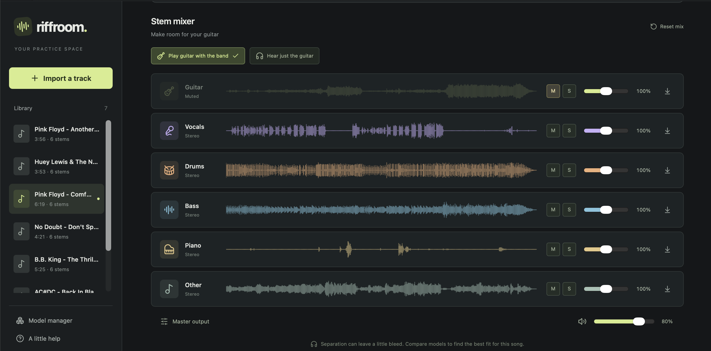
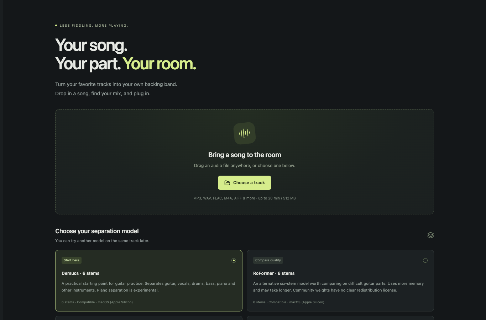
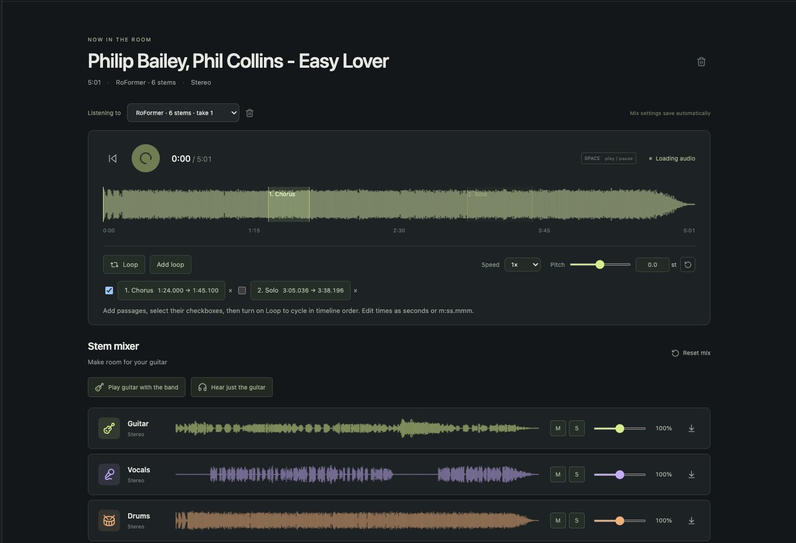

# Riffroom: turn a song into a backing track you can play with.



I built Riffroom for my own guitar practice and am sharing it in case you'd like to play with it too. Open a song, split it into instruments, then turn the guitar down or off and play along—or solo it to hear the part you're learning. Loop a tricky passage, slow it down without detuning, or transpose it to match your guitar. It all runs locally, with a mixer in your browser.

**Apple Silicon Mac and Windows x86-64 are supported song-splitting paths.** Windows has limited model availability and validation covers a specific CPU setup plus an NVIDIA GeForce RTX 4070 Ti SUPER, not every hardware or driver combination. Linux remains an unvalidated core-app experiment.

## A quick look

### Bring in a song and choose how to split it



Drop in an audio file, start with the recommended six-stem model, or choose a specialist for the part you want to practice. You can run another model later without importing the song again.

### Turn the hard parts into a practice session



Save passages such as a chorus or solo, enable the ones you want, and cycle through them in timeline order. Slow the song down, change pitch, mute the guitar, or solo any combination of stems.

## What Riffroom does

- **Make a backing track:** mix guitar, vocals, drums, bass, piano and other instruments with the six-stem options. Each separated part is called a *stem*.
- **Listen closely:** solo the guitar, mute another instrument, or combine solos to hear how parts fit together.
- **Work on a passage:** save and cycle through multiple practice loops, change speed while preserving tuning, and adjust pitch independently.
- **Start in time:** analyze the original mix for a musical beat/downbeat grid, choose a one-to-four-bar count-in, and optionally keep the click running.
- **Compare splitting methods:** keep multiple results for a song and switch between them and the original.
- **Keep your practice local:** save songs and results on your computer and download individual stems as WAV files. No account, API key, paid service or cloud upload is needed.

Song splitting is approximate: expect some instrument bleed and artifacts, especially in dense mixes. Different methods suit different songs.

## Practice

1. Choose a model, then drag an audio file into the window or click **Choose a track**.
2. Separation runs in the background; you can listen to the original while waiting. The library shows its status. One job runs at a time to limit GPU memory use.
3. **Play guitar with the band** mutes the guitar. **Hear just the guitar** solos it.
4. Use each stem's **M**, **S**, and volume slider. Volume runs from 0–200%; the master sets overall output. Multiple solos work together; mute takes precedence.
5. Seek to a passage and click **Add loop**. Name it, edit start/end as seconds or **m:ss.mmm**, or nudge either boundary by **±0.1s**. Select the loops you want and enable **Loop** to cycle through them in timeline order, skipping gaps. Space plays/pauses, and arrow keys skip five seconds when you aren't editing a control.
6. Click **Analyze beats** once for a song, then choose a 1–4 bar count-in (or Off) and optionally enable **Click**. Count-in preserves the exact playhead or loop boundary; it does not snap or move it. Pausing and resuming does not count in again.
7. Try another model from the bottom of the track page. Each completed root run remains available in **Listening to**, alongside the original.
8. Use **Split further** on a stem to run another visible, compatible model on that part. The child stems replace
   their parent in the mixer; use the split selector to return to the unsplit parent or choose another saved split.
   Splits can be chained recursively. Because each stage only receives its parent stem, leakage or missing audio
   from an earlier stage carries into every later stage.
9. Use a stem's download arrow to save its WAV file.

Mix levels, mutes, and solos are remembered per result in this browser. Track audio and all completed separation results persist on disk. Named loops and their selection checkboxes are saved with the song and shared across results. Loop mode defaults off each time the mixer opens. Play position, speed, and master output reset when changing results. Speed changes tempo while preserving tuning, and the Pitch control transposes playback independently.

## Get started

Clone, download or unzip Riffroom into a writable folder, then use the launcher for your computer. First setup needs internet access to install dependencies and build the interface. Model weights download separately when first used.

### macOS · Apple Silicon

Double-click **`Riffroom.command`**, or run this from the project folder:

```bash
./start.sh
```

The launcher prepares the project and opens **http://127.0.0.1:8765**. Keep the Terminal window open; Control-C stops the server. Launching again reuses the running app.

An M1 or newer Mac is required; 16 GB memory is recommended. The app targets macOS 14 or later with a compatible MLX wheel. Existing validation used an M1 Mac on macOS 27; the pinned dependencies may need adjustment on older macOS versions. Intel Macs are outside the current supported path.

macOS keeps the full Apple Silicon stack and prefers MLX for the curated models. Setup accepts Python 3.11–3.13 and creates a standard virtual environment in `.env`; Conda is not required. If Python, Node.js/npm or FFmpeg/ffprobe is missing, it uses Homebrew to install the missing tool. If Homebrew is missing, it prints installation guidance. Apple's command-line tools are requested only if a package needs them.

### Linux · experimental

Install Python 3.11–3.13 with venv/pip support, Node.js 22+ with npm, and FFmpeg including ffprobe using your distribution's instructions. Then, from the project folder:

```bash
bash start.sh
```

Linux uses `scripts/setup_portable.py` and `requirements-core-lock.txt` to prepare the core app without installing MLX. It reports missing system tools rather than installing them for you.

### Windows x86-64 · supported with limited model availability

Install Python 3.11–3.13 with the Python launcher or PATH option, Node.js 22+ with npm, and FFmpeg with both `ffmpeg.exe` and `ffprobe.exe` on PATH. If you already use Conda, it is an optional convenient source for Node.js/npm and FFmpeg/ffprobe; Conda is not required, and Riffroom does not create or manage a Conda environment. Open or reopen PowerShell, navigate to the project folder, and run:

```powershell
powershell -NoProfile -ExecutionPolicy Bypass -File .\Riffroom.ps1
```

`Riffroom.ps1` delegates to `start.ps1`, which uses the same portable/core setup as Linux. The execution-policy override applies only to this invocation; it does not change machine-wide policy. No administrator shell is required. Add `-NoBrowser` to start without opening a browser.

If Node.js or FFmpeg comes from an activated Conda environment, that environment may need to remain activated while Riffroom runs so those executables stay on PATH. This is the arrangement used by the successful Windows separation test: Conda supplied host tools while Riffroom's Python packages remained in the project-local `.env` virtual environment. Riffroom still runs its application Python from `.env`; it does not combine the two environments into one or manage the Conda environment.

The core app, upload flow, portable CPU separation, and CUDA-accelerated separation have been user-confirmed on Windows x86-64. Demucs 6, Demucs detailed 4, RoFormer 6, RoFormer · Kimberley vocals, and MDX23C DrumSep have completed real Windows runs; other visible portable choices are explicitly marked experimental until each exact model completes end-to-end validation there. Model Manager installs the portable engine on request; the source launcher does not install it. The managed engine includes fixed CUDA-enabled PyTorch and ONNX Runtime wheels. It uses an NVIDIA GPU when PyTorch confirms CUDA is available and otherwise keeps the validated CPU fallback. Neither the CUDA Toolkit nor developer tools are required. During installation, Model Manager reports the current safe phase and elapsed time; afterward it reports the detected GPU/backend. This evidence does not claim broad GPU, driver, or model coverage. Linux splitting remains unavailable and unvalidated. See [validation notes](docs/validation.md#cross-platform-source-launcher-mvp) for the remaining checks.

### Setup checks and limits

Later launches reuse `.env` and refresh dependencies/builds when the setup fingerprint changes. Do not copy `.env` between machines or operating systems.

To inspect prerequisites without installing packages, building or starting the server:

```bash
# macOS or Linux
bash start.sh --check
```

```powershell
# Windows
powershell -NoProfile -ExecutionPolicy Bypass -File .\Riffroom.ps1 -Check
```

Uploads are limited to **512 MB and 20 minutes**. Decoded audio and stems use substantially more memory and disk than an MP3. The browser holds the selected result in memory, so shorter tracks and fewer tabs help on a 16 GB machine. A full song can take several minutes on an M1; progress reports stages, not a promised completion time.

### Optional beat tracking and click

The click grid uses [CPJKU Beat This!](https://github.com/CPJKU/beat_this) locally. It analyzes the decoded original/full mix, so the grid remains on the song timeline when takes or nested stems change. Install the optional dependency in Riffroom's environment:

```bash
.env/bin/python -m pip install -e '.[beats]'
```

The first explicit **Analyze beats** action loads the official `final0` checkpoint and may download its roughly 78 MB weights into PyTorch's user cache; importing a song and normal playback never starts inference or a weight download. Set `RIFFROOM_BEAT_MODEL` to a local checkpoint path to use pre-provisioned weights or another Beat This! checkpoint. Analysis runs offline after weights are present and stores only timestamps plus model/version/provenance in the song manifest. Deleting a song removes its grid with the manifest but deliberately retains shared cached weights. Beat This! and its published weights are MIT licensed.

Beat tracking is optional and CPU-based in this integration, so the same path is intended for macOS, Windows, and Linux wherever Beat This!'s PyTorch/torchaudio dependencies install successfully; this does not claim completed validation on every platform. If the package, checkpoint, or inference is unavailable, Riffroom records an explicit error and leaves count-in/click controls unavailable. It never substitutes a fixed-BPM metronome or fabricated result. A valid grid may be phase-extended backward solely to schedule pre-roll before a sparse intro; persisted analysis timestamps are never modified.

### LAN access / testing another computer

The default is `127.0.0.1` (this computer only). Network binding is opt-in:

```bash
# macOS / Linux
./start.sh --host 0.0.0.0
# Optional: add --no-browser
```

```powershell
# Windows (start.ps1 accepts the same flags)
.\Riffroom.ps1 -Lan
# Optional: add -NoBrowser
```

Stop an existing server before changing its bind mode. On another computer, open the
`https://<server-LAN-IP>:8765` URL printed by the launcher and accept its self-signed
certificate warning. `-Lan` delegates to the launcher's HTTPS certificate handling;
it cannot be combined with a non-default `-BindAddress`. Using
`-BindAddress 0.0.0.0` directly remains available for plain HTTP testing, but remote
AudioWorklet playback requires a secure context and is therefore unsuitable in that mode.
Riffroom has no authentication: anyone who can reach the bound interface can access
the app and data. Use only on a trusted LAN. The HTTPS LAN launcher starts on the validated
Windows x86-64 host, but browser use was completed through SSH forwarding because direct LAN
access was blocked by the host/network firewall arrangement.

## Choosing a splitting method

These curated choices are available through the Apple Silicon setup. Windows x86-64 has a smaller validated curated catalog: Demucs 6, Demucs detailed 4, RoFormer 6, and RoFormer · Kimberley vocals. The community MDX23C DrumSep entry is also validated there; UVR-MDX-NET Inst HQ 5 and Mel-Roformer-Karaoke Aufr33-Viperx remain experimental until each exact model completes a real Windows run end to end. CPU fallback and optional NVIDIA CUDA acceleration have both completed real separations. Use Model Manager to explore entries and manage the models in your selection menus; availability depends on your platform and installed tools.

| Model | Outputs | When to use it |
|---|---|---|
| Demucs · 6 stems | Guitar, vocals, drums, bass, piano, other | Default: a dependable balance of speed, memory and independent band controls. |
| RoFormer · 6 stems | Guitar, vocals, drums, bass, piano, other | Compare with Demucs on difficult mixes. More demanding on memory. |
| RoFormer · guitar focus | All guitars, rest of band | Try the dedicated guitar extractor when you mainly need guitar isolation/removal. No individual drum/bass faders in this mode. |
| Demucs · detailed 4 stems | Vocals, drums, bass, other | Fine-tuned ensemble for rhythm-section practice. Guitar stays in Other. Slower than the default. |

There is no universal best separator for every song. Start with Demucs, compare the six-stem RoFormer, and try guitar focus when guitar clarity matters most. The smoke tests verify functioning inference and aligned output, **not perceptual superiority**. Dense distortion, effects, and overlapping instruments can leave bleed or remove useful detail. Demucs's piano output is experimental.

**Lead versus rhythm guitar:** the included models put them in one guitar stem. Research did not establish a dependable, openly available local lead/rhythm checkpoint suitable for this Mac. Riffroom does not relabel a stereo or frequency split as AI-separated lead/rhythm. The model adapter and arbitrary stem list allow such a model to be added later.

Model research, primary sources, and weight licensing are in [docs/models.md](docs/models.md). The application uses open-source tools. Community model weights have separate terms: the default Demucs option is MIT; the guitar specialist is authorized by its author for non-commercial use; the RoFormer SW weight redistribution license is unverified. Keep this distinction in mind if turning the personal app into a distributed product.

## Local files and privacy

- `data/tracks/<id>/original.wav`: imported, decoded 44.1 kHz stereo copy.
- `data/tracks/<id>/track.json`: track metadata and completed run references.
- `data/tracks/<id>/runs/<run-id>/`: model outputs, waveforms and diagnostic log.
- `data/models/`: downloaded/converted weights, reusable across songs.
- `data/runtimes/`: separately installed portable splitting engine, when requested in Model Manager.
- `.env/`: isolated, project-local standard Python virtual environment.

Deleting a track removes its Riffroom copy and results. It never touches the source file you imported. Back up `data/tracks` to preserve your library; browser local storage holds mixer preferences. Set `RIFFROOM_DATA` before launch to select another data folder: `RIFFROOM_DATA=/absolute/path ./start.sh` on macOS/Linux, or `$env:RIFFROOM_DATA = "C:\path\to\data"` in PowerShell before running the Windows launcher.

Models require internet for the initial download. Once their weights/configs are cached, normal separation runs locally. Cancelling a job keeps previous successful results and does not publish partial stems. Download files are committed atomically so interrupted downloads can be retried. Converted weights can occupy several GB; the four prepared curated profiles used roughly 3 GB on the development Mac. Other models and the optional portable engine need additional space.

The server listens on `127.0.0.1` by default and rejects unexpected hostnames. Explicit network binding permits the chosen host (any host for wildcard binds); cross-origin mutations remain rejected. It is a single-user local app, not an authenticated network service.

## Development

The stack is **Python/FastAPI + React/TypeScript/Vite + Web Audio**, with FFmpeg for decoding and MLX for the primary Apple Silicon splitting path. The portable engine uses a separate managed environment. Python suits the ML ecosystem; TypeScript keeps UI and audio state explicit. One production server serves both UI and API.

The commands below use the macOS/Linux environment layout; on Windows, the Python executable is `.env\Scripts\python.exe`. The macOS setup includes development tools; core-only installs need the `dev` extra for backend checks.

```bash
# Backend (do not use multiple workers; the job queue is local to this process)
.env/bin/python -m uvicorn riffroom.app:app --host 127.0.0.1 --port 8765

# Optional frontend dev server, in another terminal
npm run dev --prefix frontend

# Build after UI changes
npm run build --prefix frontend

# Checks
.env/bin/pytest -q
.env/bin/ruff check backend scripts
npm test --prefix frontend

# Browser integration test: uses installed Google Chrome and a running server
.env/bin/python scripts/make_test_audio.py
npm run test:e2e --prefix frontend
```

The browser test imports an original synthetic fixture, runs the real default ML model, verifies playback/mixer/loop/storage/cancellation/downloads, and deletes that test track. This workflow targets the validated Apple Silicon setup and needs GPU access and initially model-download access. See [docs/architecture.md](docs/architecture.md) for extension points and [docs/validation.md](docs/validation.md) for what was verified.

## Troubleshooting

- **First separation is slow:** weights need to download and convert once. Leave the server running.
- **Older Demucs stems sound buzzy/noisy:** the original cached-weight loader had a bug, now fixed. Select Demucs and click **Separate track** again; existing WAVs cannot be repaired in place. New workers load the corrected adapter automatically.
- **Job fails:** open its diagnostic log in the track page. Try again, or use Demucs six stems if RoFormer exhausts memory.
- **No sound:** press Play, check master/mute/solo controls and your computer's output device. Browser audio needs a user click.
- **Server was closed:** run your platform’s launcher again. Interrupted jobs are marked for retry; finished results remain.
- **Port 8765 in use:** the launcher reuses Riffroom if it owns the port; otherwise it asks you to stop the other app.
- **SDK build error:** make sure `xcrun --sdk macosx --show-sdk-path` resolves to an SDK compatible with the selected Xcode toolchain. Setup already includes the workaround used on this Mac.
- **Shared Homebrew on a multi-user Mac:** setup can use compatible tools that are already installed, including an unlinked supported Python. If another account owns Homebrew and a tool is missing, use that account or ask an administrator to install the tool.
- **No splitting options on Linux:** Linux model execution remains unavailable and unvalidated. On Windows x86-64, Model Manager can install the portable runtime for only explicitly allowlisted models. It prefers NVIDIA CUDA when detected and falls back to CPU; both paths have completed real separations under the tested configurations.
